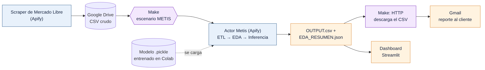
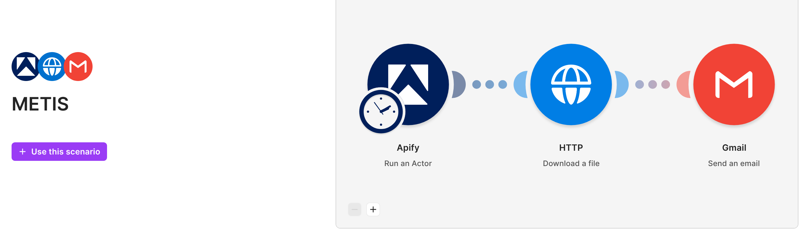

# Metis Analytics · Inteligencia competitiva en Mercado Libre

Scraping, procesamiento y predicción de productos de **seguridad electrónica** en Mercado Libre Argentina para decidir **qué vender, a qué precio y cuándo promocionar**. El mismo flujo se puede aplicar a cualquier rubro.

**Capstone Project · Samsung Innovation Campus 2026 · Comisión 1**

**Sitio web con demo interactiva:** https://spandrio.github.io/metis-capstone/web/

| Integrante | Rol | Aporte principal |
|---|---|---|
| Ramiro Spandrio | Business (líder del equipo) | Problema de negocio, métricas, dashboard, precio, presentación y la versión multirrubro (actor y modelo general) |
| Helen Garcia | Solution Engineer | Scraping en Apify, actor de inferencia y flujo de Make |
| Yamila Jordan | Data Scientist | ETL, EDA, score de costo-beneficio, comparación de modelos y modelo final |

---

## El problema de negocio

Los comercios de seguridad electrónica ponen sus precios "a ojo": relevan a mano cientos de publicaciones de la competencia, esos datos se vencen en una semana y llegan tarde a las promociones. Metis extrae las publicaciones de Mercado Libre, calcula dónde está parado cada producto frente al precio de su categoría y predice qué productos tienen **alta rotación**.

**Usuarios:** dirección, comercial, compras y marketing de un comercio del rubro.

**Datos:** Mercado Libre Argentina, extraídos el **18/11/2026** con el actor `mercadolibre-scraper` de Apify. Es un análisis **batch**: una foto del mercado en esa fecha.

| Búsqueda | Publicaciones |
|---|---|
| Cámara de seguridad wifi | 94 |
| Kit de cámaras CCTV | 330 |
| Kit alarma inteligente hogar | 278 |
| Cerraduras inteligentes | 400 |
| **Total crudo → limpio** | **1.102 → 1.077** |

---

## 1. Arquitectura y flujo



1. **Extracción:** el scraper de Apify trae las publicaciones de Mercado Libre y el CSV crudo queda en Google Drive.
2. **Orquestación (Make):** el escenario `METIS` corre el actor con el link del CSV.
3. **Actor Metis (Apify):** hace el **ETL**, genera el **EDA** y la **inferencia** con el modelo ya entrenado.
4. **Destino:** Make descarga `OUTPUT.csv` y se lo envía al cliente por Gmail. El dashboard muestra los resultados.

### Flujo de Make



`Apify · Run an Actor` → `HTTP · Download a file` → `Gmail · Send an email`

Como usamos Make, el ETL y el EDA están **encapsulados dentro del actor**. Make solo lo dispara y mueve los archivos.

---

## 2. Estructura del repositorio

```
metis-capstone/
├── actor_apify/                  # Actor de inferencia que usa Make (Python)
│   ├── my_actor/                 #   main.py (actor), etl.py, eda.py, modelo.py
│   ├── model/                    #   modelo entrenado (.pickle)
│   ├── .actor/                   #   actor.json, input/output/dataset schema
│   ├── Dockerfile
│   └── requirements.txt
├── actor_general/                # Versión multirrubro del actor (cualquier rubro)
│   ├── src/                      #   main.py (actor), fuentes.py (lectura de datos), metis_core.py (ETL), eda.py (EDA en PDF)
│   ├── model/modelo_general.pickle
│   └── entrenamiento/            #   script de entrenamiento del modelo general
├── colabs/
│   └── Capstone_DataScience_Seguridad.ipynb   # ETL, EDA, score, modelos y exportación
├── data/
│   ├── raw/                      # 4 CSV crudos del scraper (18/11/2026)
│   └── processed/                # dataset limpio (1.077 productos)
├── dashboard/                    # Dashboard en Streamlit
├── demo_local/                   # Demo local en Streamlit con los dos actores
├── docs/                         # diagrama, captura de Make, reporte EDA de ejemplo
├── branding/                     # Logo, paleta y fondos de Zoom de Metis Analytics
├── web/                          # Sitio Metis Analytics (GitHub Pages)
└── README.md
```

---

## 3. Actor de Apify

| | |
|---|---|
| **Código** | `actor_apify/my_actor/`: `main.py` (actor), `etl.py`, `eda.py` y `modelo.py` |
| **Input** | `actor_apify/.actor/input_schema.json` → `csv_url` |
| **Output** | `actor_apify/.actor/output_schema.json` y `dataset_schema.json` |
| **Modelo** | `actor_apify/model/modelo_seguridad_capstone.pickle` (entrenado en el Colab) |
| **Cómo correrlo** | `apify run` (local) o `apify push` (deploy) |

El actor **no entrena** el modelo: lo carga ya entrenado y solo predice. Tampoco guarda datos propios: recibe el CSV, lo procesa y devuelve los resultados.

---

## 4. Funciones de ETL, EDA y modelo

El código está separado por responsabilidad: `main.py` solo maneja el actor (input, salidas y logs) y la lógica vive en módulos aparte.

| Archivo | Función | Input | Output | Descripción |
|---|---|---|---|---|
| `etl.py` | `preparar_para_modelo()` | CSV crudo del scraper | DataFrame limpio | Saca duplicados, convierte precios, calcula descuento, cuotas sin interés, envío gratis, tienda oficial, combo, categoría y marca |
| `etl.py` | `filtrar_precios()` | DataFrame limpio | DataFrame filtrado | Descarta precios vacíos o fuera de $5.000 – $2.000.000 |
| `eda.py` | `resumen_eda()` | DataFrame filtrado | `EDA_RESUMEN.json` | Total de productos, precio promedio por marca, publicaciones por categoría, precio y rating por categoría |
| `modelo.py` | `cargar_modelo()` | `model/*.pickle` | pipeline de scikit-learn | Carga el modelo exportado desde el Colab |
| `modelo.py` | `predecir()` | 10 features | `prediccion` (0/1) | Predice si el producto tiene alta rotación |

**Target:** `vende_mucho` = 1 si los vendidos del producto superan la mediana de su categoría. Balance: 27,6 % alta rotación / 72,4 % estándar. Los vendidos **no entran** al modelo, para evitar leakage.

**Features (10):** marca, categoría, precio, descuento %, cuotas sin interés, envío gratis, combo, tienda oficial, rating y cantidad de reseñas.

### Modelo seleccionado

Comparamos 6 modelos de scikit-learn sobre la misma partición (validación cruzada de 5 folds y test de 216 productos):

| Modelo | Familia | CV accuracy | Test accuracy | Test F1 |
|---|---|---|---|---|
| **Random Forest** | Ensamble | **0,918** | **0,917** | **0,830** |
| Gradient Boosting | Ensamble | 0,911 | 0,917 | 0,830 |
| MLP | Red neuronal | 0,875 | 0,847 | 0,697 |
| Regresión logística | Clásico | 0,830 | 0,843 | 0,691 |
| KNN | Clásico | 0,830 | 0,824 | 0,635 |
| SVM | Clásico | 0,804 | 0,810 | 0,602 |

**Por qué Random Forest:** empata con Gradient Boosting en test, tiene la mejor validación cruzada y es más simple de explicar. Los hiperparámetros se probaron con `RandomizedSearchCV` y no mejoraron el test, así que quedó la versión base (100 árboles, profundidad 6). Train 0,940 vs CV 0,918: diferencia de 0,022, **sin overfitting**.

---

## 5. Contrato del actor de inferencia

| Campo | Dirección | Tipo | Descripción |
|---|---|---|---|
| `csv_url` | input | string | Link de descarga directa del CSV crudo (Drive) |
| filas del dataset | output | lista de objetos | Cada producto con sus variables limpias y `prediccion` |
| `prediccion` | output | integer (0/1) | 1 = alta rotación predicha |
| `OUTPUT.csv` | output | CSV (key-value store) | Mismas filas, para descargar desde Make |
| `EDA_RESUMEN.json` | output | JSON (key-value store) | Resumen del EDA del mercado |

---

## 6. Métricas

**Métrica de negocio: distancia del precio al promedio de su categoría.** Le dice al comercio si está caro o barato frente a su competencia directa. Se compara contra la propia categoría porque el precio es muy asimétrico (media $ 276.125, mediana $ 184.082).

| Banda de precio | % de publicaciones | % con alta rotación |
|---|---|---|
| Más de 10 % abajo del promedio | 64,1 % | 33,6 % |
| **Dentro de ±10 %** | **7,1 %** | 23,7 % |
| Más de 10 % arriba | 28,9 % | 15,1 % |

**KPI para el cliente:** porcentaje de sus productos dentro de ±10 % del promedio de su categoría. Los productos más baratos que su categoría rotan más del doble que los más caros.

**Score de costo-beneficio (0 a 100):** es un dato más del análisis competitivo, no la métrica de negocio. Pondera precio relativo a la categoría (35 %), rating (30 %), cantidad de reseñas (20 %) y promociones: cuotas sin interés y envío gratis (15 %). Un producto con 65 o más se marca como competitivo (50,1 % del mercado).

**Métrica del modelo:** accuracy en validación cruzada **0,918** (5 folds), accuracy en test **0,917** y F1 **0,83**.

---

## 7. Costo computacional

| Concepto | Valor |
|---|---|
| Scraping de 1.078 productos (3 corridas del 18/11) | US$ 0,49 |
| Costo estimado por 1.000 productos | ~US$ 0,45 |
| Una corrida del actor de inferencia | US$ 0,006 |
| Tiempo del ETL + EDA + inferencia (1.100 filas, local) | ~6 s |
| Make por corrida | 5 créditos (plan gratuito) |

**Precio de venta propuesto:** US$ 30 por mes por rubro con 4 corridas mensuales, cuyo costo es de unos US$ 2. Margen bruto de más del 90 %.

---

## 8. Cómo correr el proyecto

1. **Actor:** `cd actor_apify` y `apify run`. El input va en `storage/key_value_stores/default/INPUT.json`, por ejemplo `{"csv_url": "<link del CSV>"}`.
2. **Colab:** abrir `colabs/Capstone_DataScience_Seguridad.ipynb` en Google Colab y ejecutar las celdas en orden. Usa los CSV de `data/raw/` y exporta el `.pickle`.
3. **Make:** importar el escenario `METIS`: Apify Run an Actor → HTTP Download a file → Gmail.
4. **Dashboard:** `cd dashboard`, `pip install -r requirements.txt` y `streamlit run app.py`.

---

## Versión multirrubro

Como nos sugirieron, el mismo enfoque sirve para cualquier rubro. `actor_general/` recibe el nombre del rubro y sus búsquedas, o un CSV crudo, y usa variables relativas a cada categoría: el precio contra la mediana de su categoría y las reseñas contra las de su categoría. Así el mismo modelo se puede aplicar sin reentrenar. Además del CSV con las predicciones, genera el EDA en PDF (`docs/eda_reporte_actor_general.pdf`) y el dataset limpio.

---

## Mejoras después de la presentación final

Seguimos mejorando el proyecto después del 24/11:

| Fecha | Mejora |
|---|---|
| 27/11/2026 | **Identidad de Metis Analytics** (`branding/`): logo en SVG y PNG, ícono, paleta y fondos de Zoom con los colores del sitio. El sitio suma vista previa para compartir el link |
| 27/11/2026 | **Repositorio ordenado**: se borró la carpeta `metis-capstone/` de la primera subida, que duplicaba código viejo. Sigue disponible en el historial de commits |
| 27/11/2026 | **Actor general más modular**: la lectura de datos pasó a `fuentes.py`, así `main.py` solo maneja el actor. En el EDA se reemplazaron los bucles anidados por `np.ndenumerate` y `bar_label` |
| 27/11/2026 | **Sitio web Metis Analytics** (`web/`): demo interactiva con los datos reales. Incluye un chequeo de precio contra la categoría, el modelo general corriendo en el navegador con predicciones idénticas a scikit-learn, oportunidades, mapa del mercado y calculadora de ahorro |
| 24/11/2026 | **Demo local** (`demo_local/`): corre los dos actores con el mismo código del repo desde una página en Streamlit |
| 24/11/2026 | **Actor general en Apify**: input schema validado y salida sin valores NaN en el dataset, en los dos actores |
| 24/11/2026 | **Presentación final** con el caso de la clienta y la versión multirrubro |

