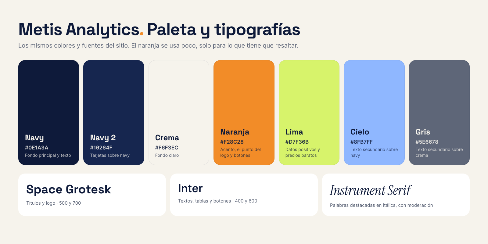

# Identidad de Metis Analytics

Logo, paleta y fondos de Zoom. Son los mismos colores y fuentes del [sitio](https://spandrio.github.io/metis-capstone/web/).

## Archivos

| Archivo | Para qué |
| --- | --- |
| `logo.svg` / `logo.png` | Logo completo sobre fondo claro: slides, documentos, firma de mail |
| `logo-sobre-oscuro.svg` / `.png` | Logo completo sobre fondo navy |
| `logo-texto.svg` / `.png` | Solo la palabra, cuando el ícono ya aparece cerca |
| `logo-texto-sobre-oscuro.svg` / `.png` | Solo la palabra, sobre fondo navy |
| `icono.svg` / `icono-512.png` | Foto de perfil de WhatsApp, Instagram o GitHub, y favicon |
| `icono-claro.svg` | Ícono en versión clara |
| `fondo-zoom-oscuro.png` | Fondo virtual de Zoom o Meet (1920 × 1080) |
| `fondo-zoom-claro.png` | Fondo virtual en versión clara |
| `paleta.png` | Paleta y tipografías en una imagen |

En los SVG el texto está convertido a trazos, así que se ven igual en cualquier computadora aunque no tenga las fuentes.

## Paleta

| Color | Hex | Uso |
| --- | --- | --- |
| Navy | `#0E1A3A` | Fondo principal y texto |
| Navy 2 | `#16264F` | Tarjetas sobre navy |
| Crema | `#F6F3EC` | Fondo claro |
| Naranja | `#F28C28` | Acento: el punto del logo y los botones |
| Lima | `#D7F36B` | Datos positivos y precios baratos |
| Cielo | `#8FB7FF` | Texto secundario sobre navy |
| Gris | `#5E6678` | Texto secundario sobre crema |

## Tipografías

- **Space Grotesk** 500 y 700 para títulos y el logo.
- **Inter** 400 y 600 para textos, tablas y botones.
- **Instrument Serif** en itálica para alguna palabra destacada, con moderación.

Las tres son gratuitas en Google Fonts.

## Reglas simples

- El punto naranja va siempre después de "metis". No se cambia de color.
- Se deja aire alrededor del logo, como mínimo el alto de la "m".
- En Zoom tu imagen se ve espejada solo para vos. Los demás leen el fondo bien.
